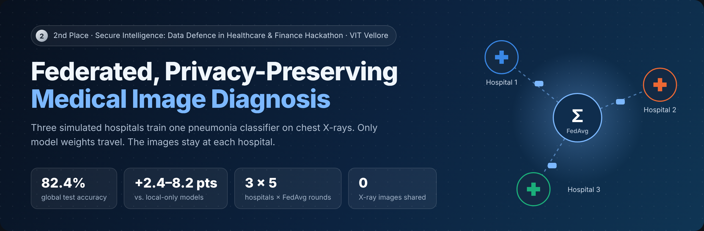
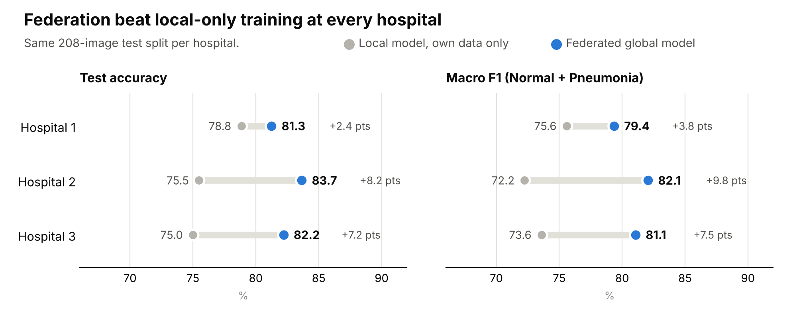
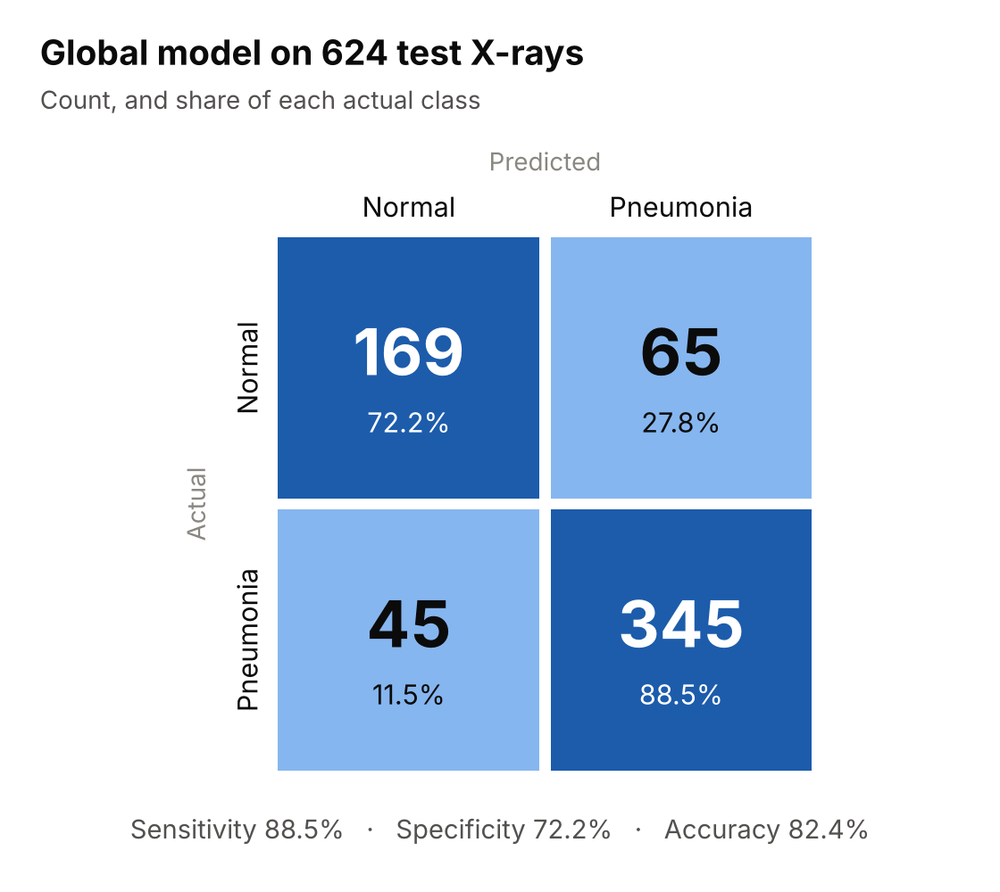
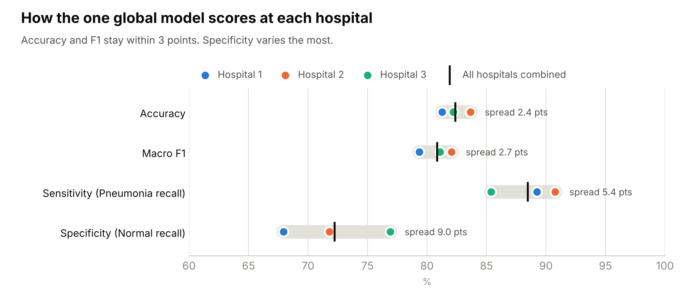
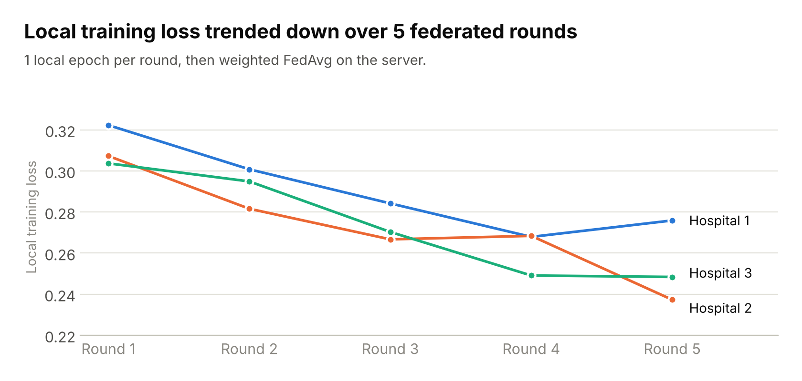
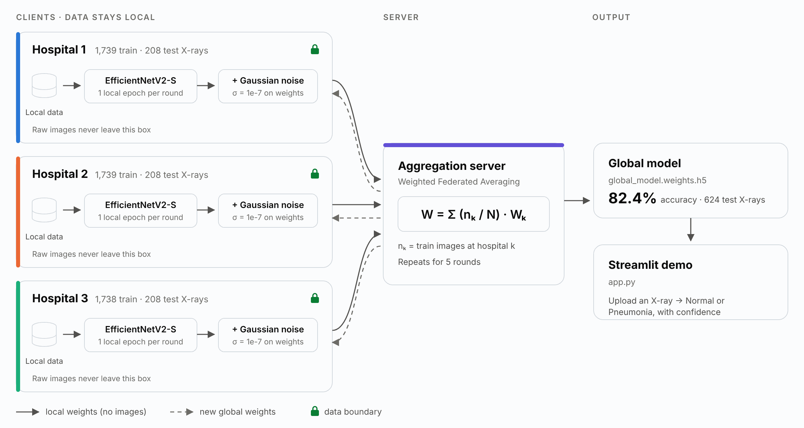
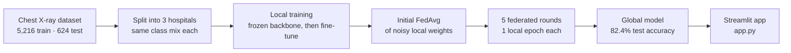
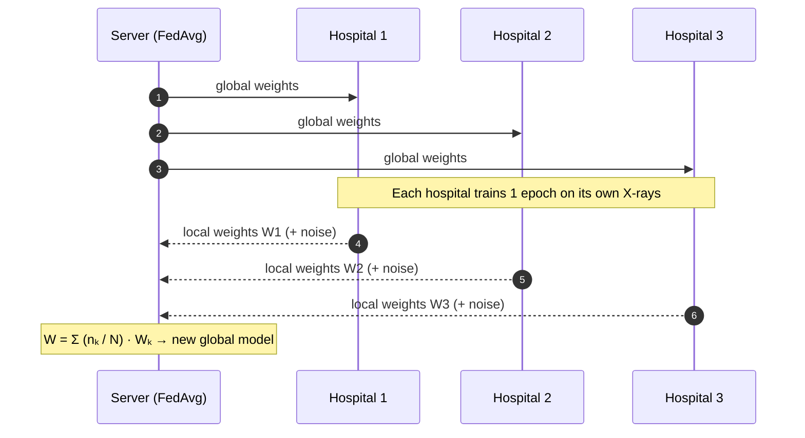
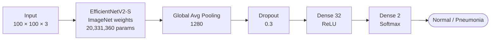
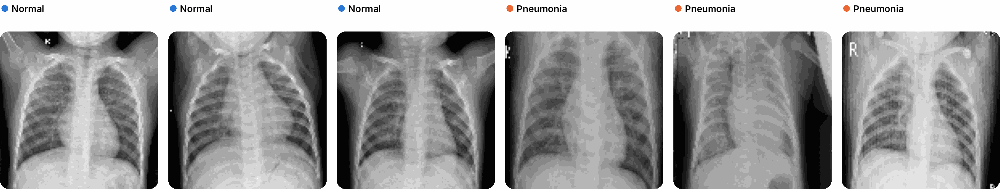

<div align="center">



<br>

[](https://www.python.org/)
[](https://www.tensorflow.org/)
[](https://arxiv.org/abs/2104.00298)
[](#-how-it-works)
[](#-privacy-layer)
[](#-demo-app)
[](docs/certificate.pdf)

**[Results](#-results)** · **[How it works](#-how-it-works)** · **[Model](#-model)** · **[Data](#-data)** · **[Run it](#-run-it-yourself)** · **[Report (PDF)](docs/project-report.pdf)**

</div>

---

Hospitals cannot pool patient X-rays. Privacy laws such as HIPAA and GDPR stop them.
This project trains **one pneumonia classifier across three hospitals without moving a single image**.
Each hospital trains on its own chest X-rays. Only model weights go to a central server.
The server merges them with **Federated Averaging (FedAvg)** and sends the improved model back.

> [!NOTE]
> 🥈 **2nd place** at the *Secure Intelligence: Data Defence in Healthcare and Finance Hackathon*,
> VITality 2025 Industry–Academia Conclave, VIT Vellore (School of Computer Science and Engineering), December 2025.
> [View certificate](docs/certificate.pdf)

## ⚡ At a glance

| | |
|---|---|
| **Task** | Chest X-ray classification: Normal vs. Pneumonia |
| **Setup** | 3 simulated hospitals · each class split equally between them · 1 aggregation server |
| **Model** | EfficientNetV2-S (ImageNet) + small dense head · 20.37 M parameters |
| **Federation** | Weighted FedAvg · 5 rounds · 1 local epoch per hospital per round |
| **Privacy** | Raw images never leave a hospital · Gaussian noise (σ = 1e-7) on shared weights |
| **Result** | **82.4 % accuracy** on 624 test X-rays · **88.5 % sensitivity** for pneumonia |
| **Gain from federation** | **+2.4 to +8.2 accuracy points** over each hospital training alone |
| **Hardware** | One laptop GPU (NVIDIA RTX 4050) · ≈6 s per hospital per round after warm-up |

---

## 📊 Results

### Federation helped every hospital

Each hospital first trained a model on its own data only. The federated global model then went through the same 208-image test split of that hospital.

<picture>
  <source media="(prefers-color-scheme: dark)" srcset="assets/charts/local_vs_federated-dark.png">
  
</picture>

### Global model on the full test set

<table>
<tr>
<td width="46%" valign="top">
<picture>
  <source media="(prefers-color-scheme: dark)" srcset="assets/charts/confusion_matrix-dark.png">
  
</picture>
</td>
<td valign="top">

**Reading the matrix**

- The model finds **345 of 390 pneumonia cases** (sensitivity 88.5 %).
- It clears **169 of 234 normal X-rays** (specificity 72.2 %).
- Most errors are false alarms on normal scans (65), not missed pneumonia (45).

For screening, a missed case costs more than a false alarm. So this error balance is the safer direction.

**Per-class F1**

| Normal | Pneumonia | Macro |
|---:|---:|---:|
| 0.754 | 0.862 | **0.808** |

</td>
</tr>
</table>

### One model, three hospitals

<picture>
  <source media="(prefers-color-scheme: dark)" srcset="assets/charts/hospital_consistency-dark.png">
  
</picture>

The notebook calls this the **bias check**. Accuracy and F1 stay within 3 points across hospitals. No hospital gets a much weaker model.

### Training across federated rounds

<picture>
  <source media="(prefers-color-scheme: dark)" srcset="assets/charts/federated_rounds-dark.png">
  
</picture>

<details>
<summary><b>Full results table</b></summary>

<br>

| Model | Evaluated on | Accuracy | Macro F1 | Sensitivity | Specificity | Loss |
|---|---|---:|---:|---:|---:|---:|
| Local only | Hospital 1 test (208) | 78.8% | 0.756 | 92.3% | 56.4% | 0.604 |
| **Federated global** | Hospital 1 test (208) | **81.3%** | **0.794** | 89.2% | 67.9% | 0.415 |
| Local only | Hospital 2 test (208) | 75.5% | 0.722 | 87.7% | 55.1% | 0.707 |
| **Federated global** | Hospital 2 test (208) | **83.7%** | **0.821** | 90.8% | 71.8% | 0.394 |
| Local only | Hospital 3 test (208) | 75.0% | 0.736 | 78.5% | 69.2% | 1.153 |
| **Federated global** | Hospital 3 test (208) | **82.2%** | **0.811** | 85.4% | 76.9% | 0.399 |
| **Federated global** | All 3 test splits (624) | **82.4%** | **0.808** | 88.5% | 72.2% | 0.402 |

**Where the numbers come from**

- Accuracy, loss and per-class F1 are printed in [`main.ipynb`](main.ipynb): each hospital section ends with a local test run, and the **GLOBAL MODEL EVALUATION** section tests the global model.
- Keras `Precision` and `Recall` on one-hot labels average over both classes. So in the notebook they equal accuracy. This README reports per-class numbers instead.
- Sensitivity and specificity come from the logged per-class F1, the error count and the class counts (78 Normal / 130 Pneumonia per hospital).
  [`scripts/make_figures.py`](scripts/make_figures.py) does this derivation. It checks that every count is a whole number and that the three hospitals add up to the global result.

</details>

---

## 🧠 How it works

<picture>
  <source media="(prefers-color-scheme: dark)" srcset="assets/diagrams/architecture-dark.png">
  
</picture>

### End-to-end pipeline



### One federated round



### Weighted Federated Averaging

The server weights each hospital by how many training images it has:

$$
W_{\text{global}} \;=\; \sum_{k=1}^{3} \frac{n_k}{N}\, W_k \qquad\text{with}\qquad N = \sum_{k=1}^{3} n_k
$$

Here $n_1 = 1739$, $n_2 = 1739$ and $n_3 = 1738$ training images.

```python
def fed_avg(weight_list, sample_counts):
    total = sum(sample_counts)
    num_layers = len(weight_list[0])
    averaged = []
    for i in range(num_layers):
        layer = sum(weight_list[k][i] * sample_counts[k]
                    for k in range(len(weight_list))) / total
        averaged.append(layer)
    return averaged
```

### 🔒 Privacy layer

| Protection | How the code does it |
|---|---|
| **Data stays local** | Each hospital reads only its own folder. The server receives weight tensors, never images. |
| **Noisy updates** | Each hospital adds Gaussian noise to every weight tensor before it sends it. This happens in the first aggregation and in rounds 2–5. |

```python
def add_dp_noise(weights, noise_scale=1e-7):
    noisy = []
    for w in weights:
        noise = np.random.normal(loc=0, scale=noise_scale, size=w.shape)
        noisy.append(w + noise)
    return noisy
```

> [!IMPORTANT]
> The noise step follows the idea of differential privacy. It is not yet a formal (ε, δ) guarantee.
> The code does not clip updates and does not track a privacy budget.
> σ = 1e-7 is small, so it does not hurt accuracy. A formal version is on the [roadmap](#-scope-and-next-steps).

---

## 🏗️ Model



| Layer | Output shape | Parameters |
|---|---|---:|
| Input | (100, 100, 3) | 0 |
| EfficientNetV2-S backbone | (4, 4, 1280) | 20,331,360 |
| Global average pooling | (1280) | 0 |
| Dropout (0.3) | (1280) | 0 |
| Dense, ReLU | (32) | 40,992 |
| Dense, Softmax | (2) | 66 |
| **Total** | | **20,372,418** |

### Training recipe

| Stage | What trains | Optimizer | Length | Stop rule |
|---|---|---|---|---|
| **1 · Local warm-up** | Dense head only (41,058 params). Backbone frozen. | Adam, lr 1e-4 | Up to 25 epochs. Stopped at 15 / 16 / 18. | Early stopping on false negatives, patience 3 |
| **2 · Local fine-tune** | Head + top 113 of 513 backbone layers | Adam, lr 1e-4 | Up to epoch 40. Hospital 1 stopped at 27. | Same rule for Hospitals 1–2. Hospital 3 ran all epochs. |
| **3 · Federated rounds** | Dense head. Backbone frozen. FedAvg merges all weights. | Adam, lr 1e-5 | 5 rounds × 1 epoch per hospital | Fixed |

Common settings: batch size 8 · categorical cross-entropy · augmentation with random flips, rotation (0.2) and zoom (0.1).
The early-stopping rule watches **false negatives**. A missed pneumonia case is the costly error.

---

## 🩻 Data

**Source:** [Chest X-Ray Images (Pneumonia)](https://www.kaggle.com/datasets/paultimothymooney/chest-xray-pneumonia) from Kermany et al. (2018). Pediatric chest X-rays, labelled Normal or Pneumonia.

<picture>
  <source media="(prefers-color-scheme: dark)" srcset="assets/samples/xray_samples-dark.png">
  
</picture>
<p align="center"><sub>Training samples as the model sees them (100 × 100 px), taken from the notebook output.</sub></p>

The notebook shuffles each class and splits it into three equal parts. So every hospital gets the same Normal / Pneumonia mix.

| | Train | Validation | Test |
|---|---:|---:|---:|
| Hospital 1 | 1,739 | 6 | 208 |
| Hospital 2 | 1,739 | 6 | 208 |
| Hospital 3 | 1,738 | 4 | 208 |
| **Total** | **5,216** | **16** | **624** |

The global test set (`GLOBAL_TEST_DATASET`) holds all 624 test images: 234 Normal and 390 Pneumonia. It is the three hospital test splits combined.

```text
MEDICAL HACKATHON/
├── chest_xray/                 # original Kaggle download
├── GLOBAL_TEST_DATASET/        # NORMAL/ , PNEUMONIA/  (624 images)
└── HOSPITAL/
    ├── hospital_1/  train/  val/  test/
    ├── hospital_2/  train/  val/  test/
    ├── hospital_3/  train/  val/  test/
    └── global_model.weights.h5 # written by the notebook
```

---

## 🖥️ Demo app

[`app.py`](app.py) is a Streamlit app for the global model.

1. Upload a chest X-ray (PNG or JPG).
2. The app resizes it to 100 × 100 and runs the federated global model.
3. It shows **Normal** or **Pneumonia** with a confidence score.

```bash
FL_WEIGHTS_PATH=path/to/global_model.weights.h5 streamlit run app.py
```

> [!WARNING]
> This is a hackathon research prototype. It is not a medical device. Do not use it for clinical decisions.

---

## 🚀 Run it yourself

```bash
# 1. Get the code
git clone https://github.com/R-PAl-AIhub/MEDICAL-HACKATHON-FEDERATED-LEARNING-WITH-DIFFERENTIAl-PRIVACY-.git
cd MEDICAL-HACKATHON-FEDERATED-LEARNING-WITH-DIFFERENTIAl-PRIVACY-

# 2. Install
pip install -r requirements.txt

# 3. Get the data
#    Download "Chest X-Ray Images (Pneumonia)" from Kaggle and unzip it to chest_xray/

# 4. Train
#    Open main.ipynb. Set SOURCE_ROOT and DEST_ROOT in the split cell, and the dataset paths, to your folders.
#    Run all cells. The notebook writes HOSPITAL/global_model.weights.h5.

# 5. Try the demo
FL_WEIGHTS_PATH=HOSPITAL/global_model.weights.h5 streamlit run app.py
```

The repo also has a [dev container](.devcontainer/devcontainer.json). GitHub Codespaces installs the requirements and starts the app. Add the weights file first.

<details>
<summary><b>Notebook map</b> — where each step lives in <code>main.ipynb</code></summary>

<br>

| Notebook section | What it does |
|---|---|
| `IMPORTING DEPENDENCIES` | Imports |
| `DIVIDING THE SOURCE FILE AMONG DIFFERENT HOSPITALS` | Splits the dataset into three hospital folders. Runs once, then writes a lock file. |
| `HOSPITAL 1` | Loads data, augments, trains the head, fine-tunes, tests, saves weights |
| `HOSPITAL 2` · `HOSPITAL 3` | Same steps for the other two hospitals |
| `FEDERATED LEARNING` · `DIFFERENTIAL PRIVACY` | Counts samples, defines `add_dp_noise` and `fed_avg`, runs the first aggregation and **5 federated rounds**, saves the global weights |
| `GLOBAL MODEL EVALUATION` | Tests the global model on the full test set and on each hospital's split. Builds the bias table and heatmap. |

</details>

---

## 📁 Repository structure

```text
.
├── main.ipynb                # full pipeline: split → local training → FedAvg rounds → evaluation
├── app.py                    # Streamlit demo for the global model
├── requirements.txt
├── assets/                   # charts and diagrams in this README
│   ├── charts/               #   built by scripts/make_figures.py
│   ├── diagrams/             #   built by scripts/diagrams/render.js
│   └── samples/              #   sample X-rays from the notebook output
├── scripts/
│   ├── make_figures.py       # rebuilds every chart from numbers logged in main.ipynb
│   └── diagrams/             # HTML sources for the banner and architecture diagram
├── docs/
│   ├── project-report.pdf    # hackathon project report
│   └── certificate.pdf       # 2nd-place certificate
└── .devcontainer/            # Codespaces / VS Code dev container
```

## 🧰 Tech stack

| Area | Tools |
|---|---|
| Deep learning | TensorFlow · Keras 3 · EfficientNetV2-S (ImageNet) |
| Federated learning | Custom FedAvg in NumPy · 3 simulated clients · 5 rounds |
| Privacy | Gaussian noise on weight updates · data kept in per-hospital folders |
| Analysis | pandas · seaborn · matplotlib |
| Demo | Streamlit · Pillow |
| Dev | Jupyter · VS Code dev container · NVIDIA RTX 4050 laptop GPU |

## 🧭 Scope and next steps

What this version does, stated plainly, and what comes next:

| Today | Next step |
|---|---|
| Three hospitals simulated as folders on one machine | Real clients over a network with [Flower](https://flower.ai/) |
| Each hospital gets the same class mix | Non-IID splits (different class mix and image sources per hospital) |
| Gaussian noise on weights, no clipping or privacy budget | DP-SGD with [TensorFlow Privacy](https://github.com/tensorflow/privacy) and a reported ε |
| Plain weight averaging | Secure aggregation, so the server sees only the sum |
| Small validation splits (16 images in the source data) | Larger held-out validation per hospital |
| Class label + confidence | Grad-CAM heatmaps to show where the model looks |

## 📚 References

- Kermany, D. S., et al. (2018). *Identifying Medical Diagnoses and Treatable Diseases by Image-Based Deep Learning.* Cell, 172(5), 1122–1131.
- McMahan, H. B., et al. (2017). *Communication-Efficient Learning of Deep Networks from Decentralized Data.* AISTATS. (FedAvg)
- Tan, M., & Le, Q. V. (2021). *EfficientNetV2: Smaller Models and Faster Training.* ICML.

---

<div align="center">

Built by **[Ratul Pal](https://github.com/R-PAl-AIhub)** · B.Tech CSE (AI & ML), VIT Vellore

<sub>If this project helped you, consider giving it a ⭐</sub>

</div>
